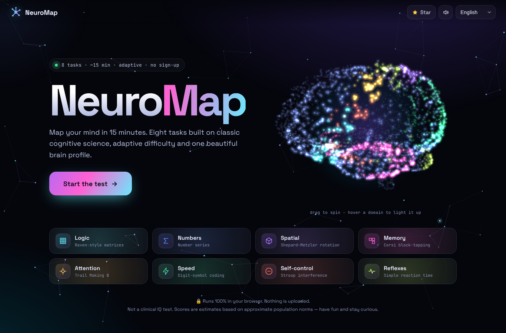
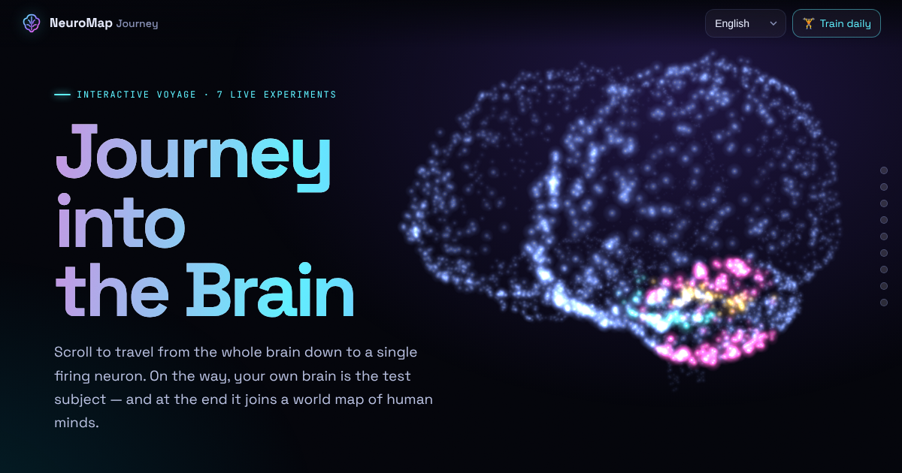

<div align="center">

# 🧠 NeuroMap

**Daily brain training + a full cognitive test, built on classic cognitive science.**
17 games, a daily workout that's the same for everyone on Earth, streaks, levels, and a living 3D brain that lights up as you train.

**[▶ Play now](https://maxmila0219-alt.github.io/neuromap/)** · **[🧠 Journey into the Brain](https://maxmila0219-alt.github.io/neuromap/journey.html)** · Installable app (PWA) · Works offline · No frameworks · No tracking · 10 languages



</div>

---

## 🩻 NEW in v6: a real brain, ray-marched on your GPU

The brain is no longer a particle sketch. NeuroMap now loads a real 3D MRI volume, the **MNI ICBM152** average brain built from 152 people, and ray-marches it in a WebGL2 fragment shader.

- **MRI mode.** Each pixel finds the cortical surface, refines it with a bisection search and lights it with gradient normals, ambient occlusion, a key/fill/rim light rig and filmic tonemapping. Every gyrus and sulcus is real anatomy.
- **X-ray mode.** Emission–absorption volume rendering with edge glow, overlaid with the DTI-style fibre tractography.
- **Live slicing.** Sagittal, coronal or axial cuts show the real MRI cross-section, with grey matter, white matter, ventricles, hippocampus and cerebellum.
- **Your training on real anatomy.** Each skill glows at the MNI coordinates of the network that research links to it. The glow is a smooth Gaussian field with flickering cortical "activity" that sits on the gyral crowns. Click the cortex and the GPU-picked region flies you inside.
- **Journey.** The organ chapter becomes an X-ray, then a scroll-driven axial scan. The lobes light up on the real cortex, and the dive zooms into real gyri.

Files: `brain_hd.bin` (desktop, ~2 MB) and `brain_sd.bin` (phones, ~1 MB). Each one is a gzip of a JSON header, an 8-bit T1 volume and region labels. Phones keep the particle brain by default because the MRI is one tap away. Add `?nomri` to disable it.

**Attribution (required by the template licence):** MNI ICBM152 2009 nonlinear template, Copyright (C) 1993–2009 Louis Collins, McConnell Brain Imaging Centre, Montreal Neurological Institute, McGill University. Fonov V.S. et al. (2011), *NeuroImage* 54:313–327; Fonov V.S. et al. (2009), *NeuroImage* 47:S102.

## 🧬 NEW in v5: a living brain

- **WebGL engine** (`neurogl.js`, no dependencies): tens of thousands of glowing particles, HDR bloom, filmic tonemapping and adaptive resolution for weak phones. It falls back to the 2D renderer automatically.
- **My brain**: your own brain grows from your real training data.
  - 8 regions light up by skill and are linked by white-matter tracts.
  - Tap a region to fly *inside* it, into a **cortical column of procedurally grown neurons**. You see pyramidal cells and interneurons, dendrites with spines, axons, myelin sheaths with nodes of Ranvier and synaptic boutons.
  - The network is a real **leaky integrate-and-fire spiking network** with conduction delays. Impulses travel along axons and cross synapses, and they jump from node to node when myelinated. Tap to make neurons fire.
  - Practice adds neurons and synapses, consistency adds myelin (signals get faster), and regions you don't train fall asleep.
  - Every region shows your progress since day one, trend, percentile, next milestone and a real finding from neuroscience.
  - **Brain tour** flies the camera through your brain, region by region.
- **Journey into the Brain 2.0**: a GL brain with a continuous zoom from the whole organ into a firing cortical network, plus 4 new experiments: hearing range ("how old are your ears"), attentional blink, Müller-Lyer illusion and number sense (Weber fraction, fitted by maximum likelihood).

- **Glass brain + tractography** (v5.1): a translucent glass cortex, built with naive surface nets from the particle density field, with fresnel rim, thin-film iridescence and an MRI-style scan plane. Inside it run ~1000 white-matter streamlines coloured with the real **diffusion-MRI convention** (red = left↔right, green = front↔back, blue = up↔down).
- **Cinematic post-processing**: depth of field (bokeh), ACES filmic tonemapping, lens chromatic aberration, HDR bloom.
- **Bullet-proof on phones**: the engine draws a probe frame through the whole HDR pipeline and reads it back. If a GPU can't render half-float targets it switches to 8-bit; if it still fails, it hands over to the 2D renderer and remembers that choice. Add `?gldebug` to the URL to see renderer, format and fps, and `?gl` to re-enable 3D.

> Honesty note: the neurons, synapses and myelin in "My brain" visualise *your practice* (a metaphor for neuroplasticity). They are not a scan of your real brain.

---

## 🧠 NEW: Journey into the Brain

**[Open the journey →](https://maxmila0219-alt.github.io/neuromap/journey.html)**



A scroll-driven voyage from the whole brain down to a single firing neuron. A 3D particle brain follows your scroll, lights up each lobe, then dives through the cortex. On the way, your own brain becomes the test subject:

| Chapter | Live experiment | Classic source |
|---|---|---|
| 👁 Vision | Find your **blind spot** and watch your brain fill it in · the **lilac chaser** illusion | Mariotte 1668 · Troxler 1804 · Hinton 2005 |
| 🔢 Parietal lobe | **Instant counting**: find your subitizing limit | Kaufman et al. 1949 |
| 🛑 Frontal lobe | **Stroop test**: measure your conflict cost in ms | Stroop 1935 |
| 🌀 Temporal lobe | **False memory**: your brain "remembers" a word it never saw | Roediger & McDermott 1995 |
| ⚡ Motor system | **Reaction time**, with the signal path from eye to finger | — |
| 🔬 Neuron | A real **Hodgkin–Huxley** model running live: stimulate, hold current, remove myelin, add pufferfish toxin | Hodgkin & Huxley 1952 |
| 👂 Temporal lobe | **Hearing range**: how old are your ears? | ISO 7029 · Rodríguez Valiente et al. 2014 |
| ⏱ Attention | **Attentional blink** in a 10-per-second letter stream | Raymond, Shapiro & Arnell 1992 |
| 📏 Vision | **Müller-Lyer** illusion strength in % | Segall et al. 1966 |
| 🎯 Parietal lobe | **Number sense**: your Weber fraction | Halberda et al. 2008 |
| 🌍 Global Brain | Anonymous results on an **open world map**, "when is humanity fastest?" chart, shareable brain card, friend challenges | — |

### 🌍 Global Brain backend (optional, free)
Without a backend the journey runs 100% locally. To switch on the live world map:
1. Create a free project at [supabase.com](https://supabase.com).
2. Open **SQL Editor**, paste [`global-brain.sql`](global-brain.sql) and run it. This creates an insert-only table plus an aggregate function. Raw rows are never public, and countries with fewer than 5 participants are hidden.
3. In `journey.html`, fill in `const GB={url:'https://YOUR-PROJECT.supabase.co',key:'YOUR-ANON-KEY'}`. The anon key is designed to be public; security comes from row-level security.

Data sent: country, age group, hour of day, language and four scores. No names, accounts or cookies.

---

## 🎮 17 games (v3)

| Domain | Games |
|---|---|
| Logic | Matrices · **Odd one out** (classification reasoning) |
| Numbers | Number series · **Number sense** (dot comparison, Weber fraction; Halberda et al., 2008) |
| Spatial | 3D rotation · **Flip or turn** (2D rotation; Cooper & Shepard, 1973) |
| Memory | Corsi blocks · **N-back** (Jaeggi et al., 2008 staircase) |
| Attention | Trail connect · **Ball tracker** (multiple-object tracking, Pylyshyn & Storm, 1988) · **Hidden T** (visual search, Treisman & Gelade, 1980) |
| Speed | Symbol code · **Pattern match** (Salthouse & Babcock, 1991) |
| Self-control | Color clash (Stroop) · **Arrow focus** (Eriksen flanker, 1974) |
| Reflexes | Reaction · **Go / No-Go** |

- **Real physics.** In Ball tracker, balls collide with perfectly elastic impulses. Momentum and kinetic energy are conserved, and the simulation is verified to machine precision.
- **Every game remembers your level.** N-back's N, the number of tracked balls, the dot ratio, the search set size and the symbol length all persist and adapt.
- **30 achievements**, ranks from Novice to Mastermind, a profile with a name and avatar, and a shareable brain card.
- **Daily duels.** Share your daily score and your friend's app shows "Alex scored 2,100 on Daily #12. Beat it!"
- **Ambient color.** Each brain domain tints the whole screen while you play.

## 🏋 Daily training

- **Daily workout.** Three games, about 5 minutes. The set is chosen by date, so everyone in the world plays the same workout that day.
- **Streaks, XP and levels.** Come back daily to keep your 🔥 streak alive.
- **Adaptive difficulty.** Every game starts at *your* level. Logic and number puzzles use your IRT ability estimate, and Corsi starts at your span.
- **Brain index.** Per-domain skill is an exponential moving average of your age-normed scores. Your brain map lights up region by region as you play.
- **Progress screen.** A 30-day chart, an activity calendar and 11 achievements.
- **Wordle-style sharing.** `NeuroMap Daily #12 🧠 🟪🟩🟨 2,140 🔥 5`
- **Free play.** Any of the 8 games, any time.
- **Installable.** Add it to your home screen. It works offline through a service worker.

> Training makes you better at *these tasks*. Evidence that brain-training transfers to general intelligence is weak, so NeuroMap never claims to raise IQ. It helps you track your skills honestly.

## ✨ What makes it different

- **A living 3D brain.** About 3,800 particles form an anatomically shaped brain: frontal, parietal, temporal and occipital lobes, plus the Sylvian and central sulci, the cerebellum and the brainstem. Drag it to spin it (it has inertia). After the test, each region glows according to your score.
- **Hand-written 3D renderer** for the mental-rotation task. It uses perspective, two-light shading, cube outlines, contact shadows and a holographic pedestal. A gentle ±6° sway gives motion parallax, so the depth is unambiguous. The renderer has no WebGL and no libraries.
- **Every puzzle is generated procedurally.** Nothing is stored, nothing can be googled, and every run is unique.
- **Real adaptive testing.** Logic and number tasks use IRT, with an EAP ability estimate and a guessing parameter.
- **Age-normed scores.** Results are compared with your own age group.
- **Your cognitive type.** You get an archetype based on your strongest domain: The Strategist, The Architect, The Pilot and so on.
- **Friend duels.** A challenge link gives your friend *the same puzzles* and then overlays both brain maps: "You win by 7 points!".
- **Share cards.** Download a 1080×1350 PNG with your index, your type and your glowing brain.
- **Resume anytime.** Progress is saved after every task.
- **100% private.** Everything runs in your browser.

## 🔬 The eight tasks

| Domain | Task | Based on | Metric |
|---|---|---|---|
| Logic | 3×3 matrices built from Carpenter's rule taxonomy: progression, distribution, XOR, addition | Raven's Progressive Matrices | IRT θ |
| Numbers | Number series, 8 difficulty levels | Number-series tests | IRT θ |
| Spatial | Same object or mirror image? Angles 40°–160° | Shepard & Metzler (1971) | Accuracy, RT, **rotation speed °/s** |
| Memory | Repeat sequences of lit blocks (1 block/s) | Corsi; Kessels et al. (2000) | Span |
| Attention | 1 → A → 2 → B … | Trail Making Test B | Time + errors |
| Speed | Symbol → digit, 60 s | WAIS Digit-Symbol Coding | Correct/min |
| Self-control | Name the ink color, not the word | Stroop (1935) | Inverse efficiency score |
| Reflexes | Click when the field turns green | Simple reaction time | Median RT |

## 📐 Methodology

1. **Practice trials.** Stroop and mental rotation start with unscored practice and feedback, as in standard psychometric administration.
2. **Raw → z-score** using approximate adult norms from the literature.
3. **Adaptive items.** Logic and Numbers use EAP estimation with an N(0,1) prior and a 3PL-style model (c = 1/6 and 1/5).
4. **Mental rotation.** RT is regressed on angle for correct "same" trials. The slope gives your mental rotation speed, which is the classic Shepard–Metzler finding.
5. **Age adjustment.** Cross-sectional decline per decade after age ~22, in SD units, after Salthouse (2009, 2010): speed .28, attention .24, reflexes/spatial/logic .20, memory .18, self-control .16, numbers .15.
6. **Input-latency correction.** Touchscreens add about 35 ms, so the reaction-time norm is shifted for touch input.
7. **Validity check.** Leaving the tab during a task is flagged on the results.
8. **Composite.** The index is computed as

   `z = Σ wᵢ·zᵢ / √(Σwᵢ² + ρ·Σᵢ≠ⱼ wᵢwⱼ)`

   The weights are approximate g-loadings and ρ = 0.30. The result is scaled to 100 ± 15, with a 95% range from SEM = 15·√(1 − .88).

> ⚠️ **NeuroMap is not a clinical IQ test.** The norms come from published literature, not from a standardization sample. Brain regions are illustrative: they show the areas most associated with each ability in neuroimaging research, not a scan of your brain.

## 🚀 Deploy

```bash
open index.html            # works offline, just open it
# GitHub Pages: Settings → Pages → Branch: main → / (root)
```

Files: `index.html` (the whole app), `manifest.webmanifest` + `icons/` (install as an app), `sw.js` (offline cache). Your progress is stored only in your browser (`localStorage`).

Before publishing, set the `REPO` constant at the top of the `<script>` to your repository URL. It powers the ⭐ button and the share card.

**Links**
- `?seed=AB12C`: the same puzzles for everyone who opens it
- `?seed=AB12C&vs=…`: a duel against a friend's score
- `#r=…`: a read-only shared result
- `?lang=ru`: force a language

## 🌍 Add a language

Copy the `en` blocks in `I18N` and `I18N_EXTRA`, translate them, add the language to `LANGS`, and open a PR. Missing keys fall back to English.

Supported: English, Русский, Español, Português, Français, Deutsch, 中文, 日本語, हिन्दी, العربية (RTL).

## 🛠 Tech

Vanilla JS, Canvas 2D and SVG. It includes a seeded PRNG (mulberry32), WebAudio sound with no audio files, and haptics on mobile. It respects `prefers-reduced-motion`.

## 📄 License

MIT
